# claude-comptroller

A self-hosted control tower for a small team's Claude Code traffic. ("Comptroller" is pronounced "controller".)

You run one Windows service on a server you own. Every developer's Claude Code sends its requests through it to Anthropic. The service knows who sent each one (Windows user and computer), records what it needs for the books, and gives you one switch per person or computer. Developers keep using their own Claude Team, Pro or Max seats: the service holds no Anthropic credential and never stores a prompt or a reply.

<table>
<tr><td>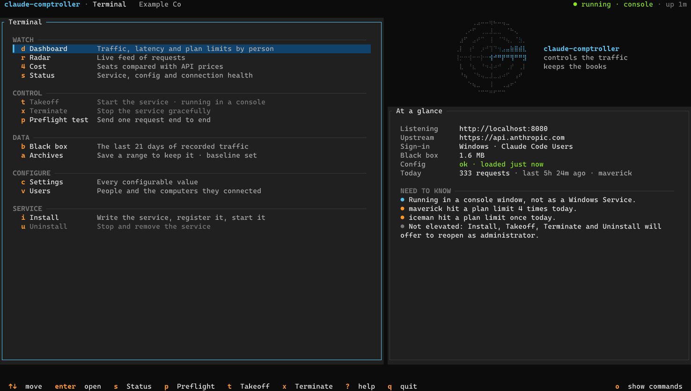<br><b>Terminal</b> · the admin terminal's home screen, where everything starts. Every action is one key.</td></tr>
</table>

*All pictures are drawn from made-up example data (`tools/screenshots.ps1`).*

Not affiliated with or endorsed by Anthropic.

## What you get

- **Who is using Claude Code, and how much.** Requests, latency, errors and plan-limit hits (429s) per person and computer, live or by day.
- **Are the seats worth it?** Each person's seat price against what their recorded tokens would cost at API list prices, for the billing month or the whole seat year.
- **One place to cut access.** Suspend a computer, revoke a person, or require everyone to be in one Windows group.
- **Records you control.** Metadata only, kept for as many days as you choose, with archives of the ranges you want to keep.

What it doesn't do:

- It never sees or stores prompts, replies or passwords, and never adds an API key. Developers stay on subscription billing.
- It covers **Claude Code** only (the CLI, the VS Code extension and the Claude Desktop Code tab). Claude Desktop's Chat and Cowork tabs don't go through it.
- It talks only to `api.anthropic.com` and your own Active Directory. Nothing else leaves your network.

## Status

Early. It's been built and tested on single machines against a fake Anthropic and, for the parts in [docs/testing-status.md](docs/testing-status.md), the real one. Try it with a few people before relying on it.

| Part | State |
| - | - |
| Proxy to `api.anthropic.com` | Works |
| Identity: Windows sign-in or one-time codes, device tokens, disconnect and reconnect | Works |
| Windows service, health endpoint, setup page for developers | Works |
| Tray app for developer computers | Works |
| Recording each request with its token usage | Works against the fake upstream; not yet checked against the real API |
| Admin terminal: install, start, stop, status, preflight test, settings, users, radar, dashboard, cost, black box, archives and baseline | Works |
| HTTPS, with a certificate from the Windows store | Works |
| Sign-in through an identity provider (OIDC) | Not built |

## How it works

```
 developer computer                          your server
 ┌──────────────────────────────┐            ┌──────────────────────────────────────┐
 │ claude-comptroller-connect   │──sign-in──▶│ claude-comptroller-service           │──▶ api.anthropic.com
 │ (tray app)                   │            │  checks the token, removes it,       │
 │ Claude Code ─────────────────│──requests─▶│  forwards, records metadata          │
 └──────────────────────────────┘            │ claude-comptroller (admin terminal)  │
                                             └──────────────────────────────────────┘
```

1. A developer runs the tray app once. It signs in to your server (silently with Windows, or with a one-time code) and receives a token for that computer.
2. It points Claude Code at your server with `ANTHROPIC_BASE_URL`, and adds the token as the header `X-Comptroller-Token` through `ANTHROPIC_CUSTOM_HEADERS`. Nothing else changes.
3. The service checks the token, removes it, and forwards the request with the developer's own Claude login untouched.
4. When the reply finishes, it records who sent it, when, the path, status, time taken and size, and for model replies the model and token counts, read as the reply streams past without holding it up.

Never set `ANTHROPIC_AUTH_TOKEN`, `ANTHROPIC_API_KEY` or `apiKeyHelper` on those computers: any of them switches Claude Code to API billing.

The endpoints and error messages are described in [contracts/api.md](contracts/api.md).

## Set it up

### What you need

- **A 64-bit Windows server** (Windows Server, or Windows 10/11) that developers can reach. It needs no .NET or other runtime: everything is in one exe.
- **Developer computers** on Windows 10 or 11 with Claude Code, each person signed in to their own Claude account.
- **For Windows sign-in:** the server and the developer computers in the same Active Directory domain, and a group for the people allowed to use it (by default `Claude Code Users`). Without a domain, use one-time codes instead (`Identity.Mode` = `manual`).

### 1. Install the service

1. Download `claude-comptroller-<version>-win-x64.zip` from [Releases](../../releases), check it against `SHA256SUMS.txt`, and unzip it on the server.
2. Open a terminal **as administrator** and run `claude-comptroller.exe`.
3. Press `i`. It writes the service to `%ProgramFiles%\claude-comptroller`, a default `comptroller.json`, and the tray app for developers to download; registers the service (delayed automatic start, restart on crash, virtual account `NT SERVICE\claude-comptroller`); starts it; and runs the preflight test, which sends one request through to Anthropic without credentials and checks that replies stream unbuffered.

<table>
<tr>
<td width="50%" valign="top">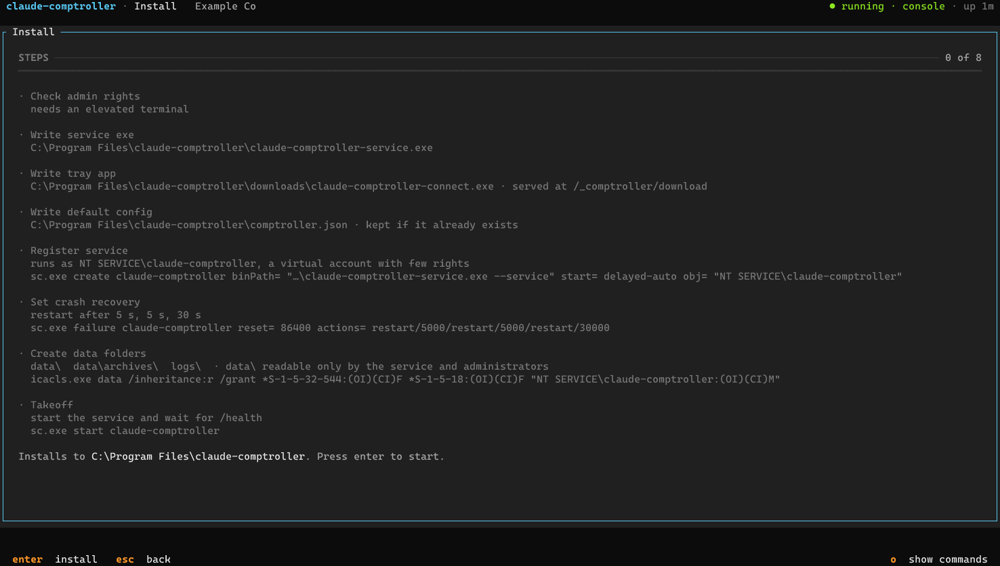<br><b>Install</b> · each step, with the command that does the same by hand</td>
<td width="50%" valign="top">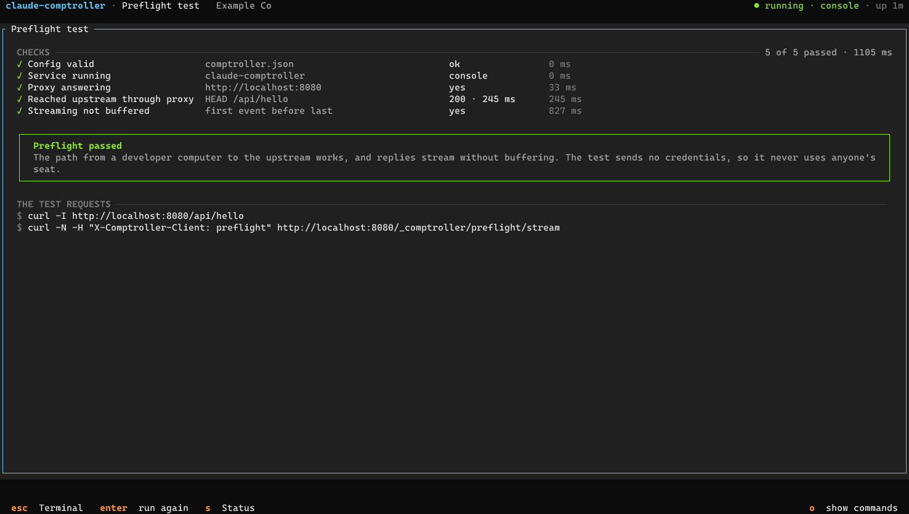<br><b>Preflight test</b> · runs after Install, and any time with <code>p</code></td>
</tr>
</table>

### 2. Turn on HTTPS and let developers reach it

Out of the box the service listens on `http://localhost:8080` and accepts only the server itself. Every request carries the developer's device token, their own Claude login and the prompt itself, so anything beyond the server itself should use HTTPS.

1. **Get a certificate** for the name developers will use, such as `claude.example.internal`. Use one from your company's certificate authority (with Active Directory Certificate Services: `certlm.msc` → Personal → Request New Certificate, with a Web Server template) or from a public one. Claude Code and the tray app trust what Windows trusts, so a company CA works on domain computers with nothing to set up on them. A self-signed certificate would have to be trusted by hand on every computer.
2. **Import it** into the computer's store, if it came as a `.pfx`:
   ```powershell
   Import-PfxCertificate -FilePath claude.pfx -CertStoreLocation Cert:\LocalMachine\My -Password (Read-Host -AsSecureString)
   ```
3. **In the admin terminal**, press `c` (Settings) and change:

   | Setting | To |
   | - | - |
   | TLS → Certificate | press enter and choose it from the list. Saving also lets the service's account read its private key |
   | Proxy → Listen URL | `https://+:8443`, to listen on every address |
   | Access → Allowed addresses | your developers' networks, such as `10.0.0.0/8` |
   | Identity → Allowed group | your group's name or SID |
   | General → Organization name | shown to developers in the tray app and on the setup page |

Save with `s`. The certificate and listen URL need a restart, which it offers. The preflight test (`p`) then checks the certificate the way developers' computers will: that Windows trusts it, that it names the server, and how long it has left. Status (`s` on the home screen) shows the certificate and the health checks, and the home screen warns a month before it expires.

Plain HTTP (`http://+:8080`) still works, for a network you fully trust, but the home screen warns about it.

<table>
<tr>
<td width="50%" valign="top">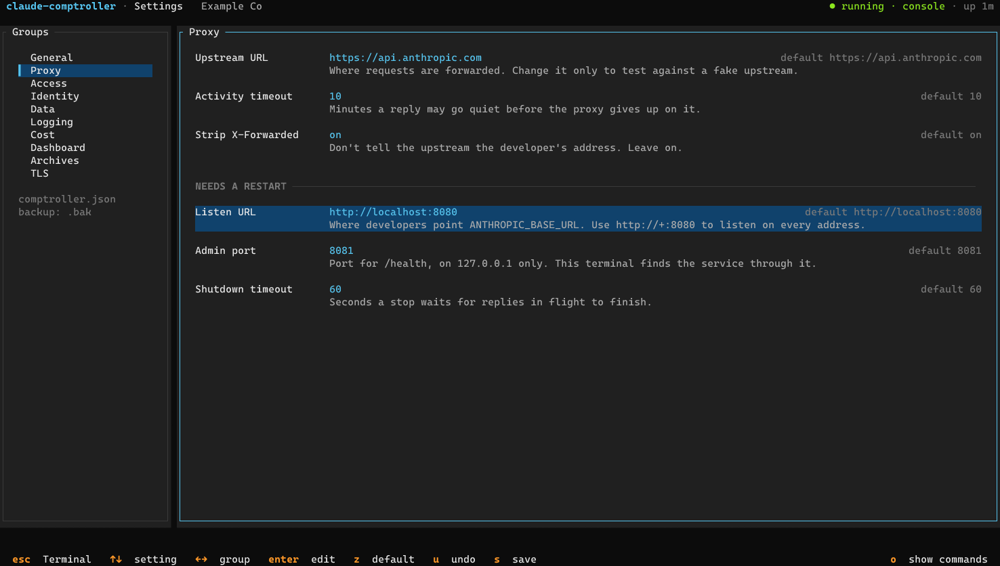<br><b>Settings</b> · every value in comptroller.json, with its default and limits</td>
<td width="50%" valign="top">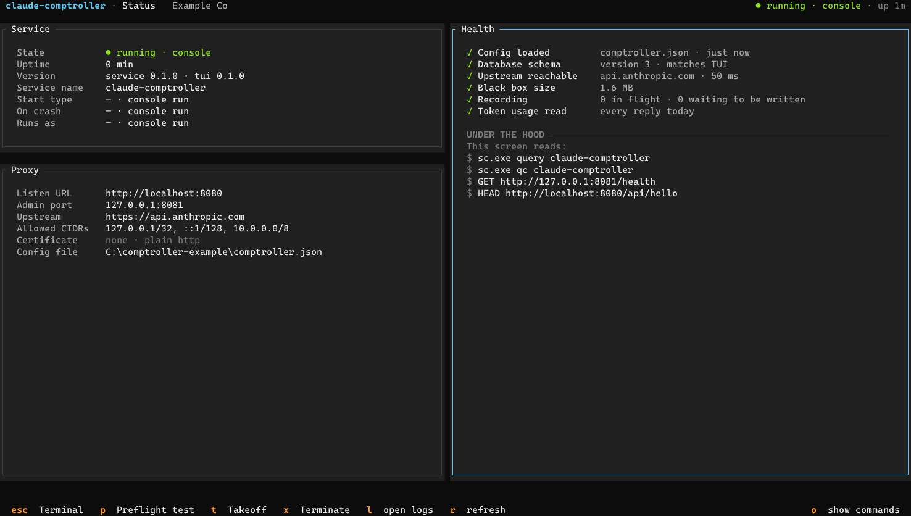<br><b>Status</b> · the service, the proxy and the health checks</td>
</tr>
</table>

Then open the port in Windows Firewall, in an administrator PowerShell:

```powershell
New-NetFirewallRule -DisplayName "claude-comptroller" -Direction Inbound -Protocol TCP -LocalPort 8443 -Action Allow
```

When the certificate is renewed, choose the new one in Settings → TLS and restart: Windows gives a renewed certificate a new thumbprint.

### 3. Connect developers

Send developers the setup page: **`https://<your server's name>:8443/_comptroller/download`**. It has the tray app, its SHA-256, and the steps for your sign-in mode. In short:

1. Run `claude-comptroller-connect.exe`, which sits by the clock.
2. Enter the server address when asked.
3. With Windows sign-in, that's all; with one-time codes, enter the code you gave them (Users screen, `n`).
4. Restart VS Code once.

The tray app writes only `ANTHROPIC_BASE_URL` and `ANTHROPIC_CUSTOM_HEADERS`, to `%USERPROFILE%\.claude\settings.json` (the CLI and the Desktop Code tab) and VS Code's user `settings.json` (the extension). Everything else in those files, including comments, is kept, and the originals are backed up under `%APPDATA%\claude-comptroller\backups`.

To roll it out with Intune or Group Policy instead, use `claude-comptroller-connect-<version>-win-x64.zip` from the release; it's the same exe. It starts with Windows (a per-user Run key), and works without admin rights.

**Disconnect** in the tray app blocks Claude Code on that computer until the developer reconnects; it doesn't remove the settings, because that would send Claude Code straight to Anthropic. **Remove comptroller settings** in its right-click menu puts the original files back. Do that before uninstalling it, or whenever the server is going away.

As people connect, they appear on Users (`v`) with each computer they use. From there you suspend, revoke or remove a computer or a person.

<table>
<tr><td>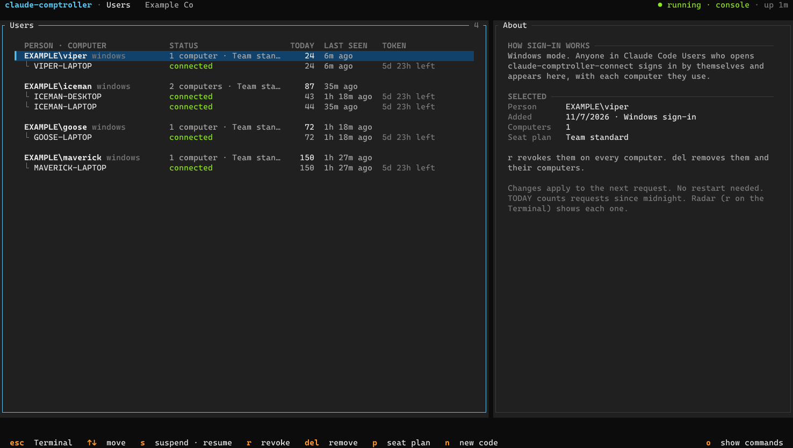<br><b>Users</b> · each person and their computers, with requests today, last seen and token expiry</td></tr>
</table>

### 4. Tell it about your seats

On Cost (`4`), press `s` to enter your seat plans (for example Team standard, annual, with its price and renewal date), then on Users (`v`) press `p` to put each person on a plan. From then on, Cost compares each seat with what the same tokens would cost at API prices.

<table>
<tr>
<td width="50%" valign="top">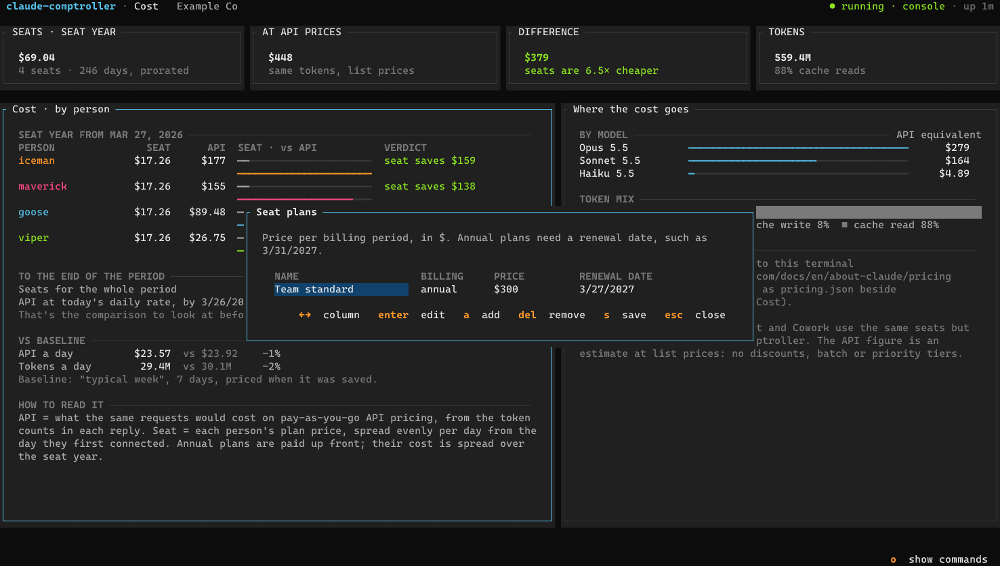<br><b>Seat plans</b> · <code>s</code> on Cost: name, billing period, price and renewal date</td>
<td width="50%" valign="top">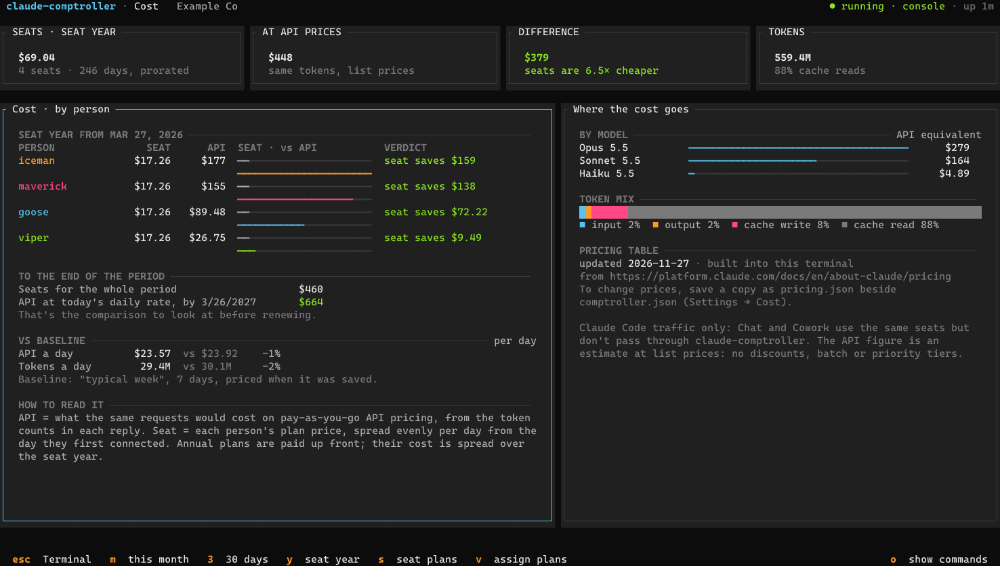<br><b>Cost</b> · each seat against API prices, here over the seat year</td>
</tr>
</table>

## The admin terminal

`claude-comptroller.exe` is the only command an admin types. Every action is a key on its home screen, and each step shows the `sc.exe`, `icacls` or `sqlite3` command that does the same by hand. Installing, starting, stopping, saving settings and changing users need an administrator terminal; if it isn't one, it offers to reopen itself as administrator.

| Key | Screen |
| - | - |
| `d` | **Dashboard**: today or the last 7 or 14 days (`p`): requests per hour or day against the period before (or the baseline), each person's share with their plan-limit hits and p95, latency, and the latest requests |
| `r` | **Radar**: a live feed of requests, with requests in flight first. `f` picks a person, `e` shows only errors and plan limits, space pauses, enter shows one request |
| `4` | **Cost**: each person's seat cost against their tokens at API list prices, for the billing month (`m`), the last 30 days (`3`) or the seat year (`y`), with a projection to renewal, a breakdown by model, the token mix, and cost per day against the baseline. `s` edits the seat plans |
| `s` | **Status**: the service, the proxy and the health checks, with the commands they read |
| `t` · `x` | **Takeoff** (start) and **Terminate** (stop; replies in flight finish first) |
| `p` | **Preflight test**: config, service, proxy, a request through to Anthropic, and that replies stream without buffering. It sends no credentials, so it uses no seat |
| `b` | **Black box**: recorded requests per day, the oldest and newest, and the nightly prune. `p` prunes now, `n` archives a range |
| `a` | **Archives**: save a range of days so it outlives the prune, make one the **baseline** (`b`) that the Dashboard and Cost compare against, or open one on Cost (enter) |
| `c` | **Settings**: every value in `comptroller.json` with its default and limits. Saving keeps comments and the rest of the file, and the old file as `comptroller.json.bak`. Settings read only at startup are marked, and saving one offers to restart the service |
| `v` | **Users**: each person and their computers, with status, requests today, last seen and token expiry. Suspend, resume, revoke or remove; put a person on a seat plan (`p`); in `manual` mode, create a one-time code (`n`) |
| `i` · `u` | **Install** and **Uninstall** (stops and removes the service; data, logs and config are kept unless you choose otherwise) |

A computer the developer disconnected from the tray app can only be reconnected by them. An admin suspension can only be lifted by an admin.

Day to day, the Dashboard shows the day or the week at a glance, and Radar shows each request as it happens:

<table>
<tr>
<td width="50%" valign="top">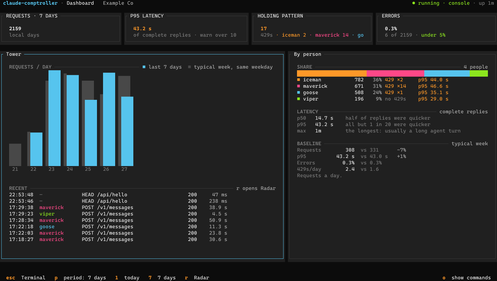<br><b>Dashboard</b> · the last 7 days against the baseline week</td>
<td width="50%" valign="top">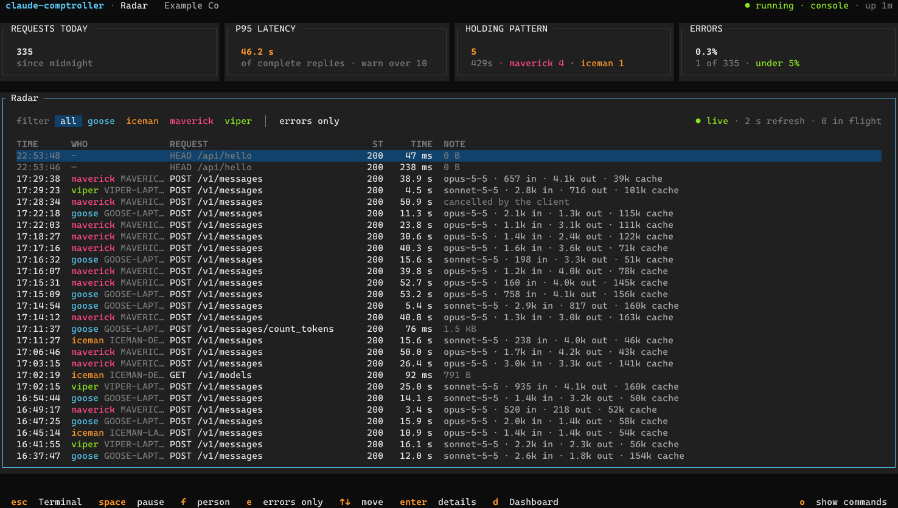<br><b>Radar</b> · every request as it happens</td>
</tr>
</table>

## Records, retention and archives

Each request's row holds the time, person, computer, client address, path, status, time taken and sizes, and for model replies the model and token counts. Never a prompt or a reply. Rows live in `data\comptroller.db` (SQLite), readable only by the service and administrators.

- **Retention:** the service keeps today and the `Data.RetentionDays − 1` days before it (14 days by default), and deletes older rows each night at `Data.PruneTime` and once when it starts.
- **Archives:** a range of days saved to its own file in `data\archives`, named for its range. A summary keeps the traffic figures, requests by weekday and hour, and the cost report together with the pricing table and seat plans used, so it reads the same after prices change. A raw archive also keeps a copy of every request. The prune never touches archives. Each is a SQLite file with an `archive` table of keys and values (and `requests` if raw).
- **Baseline:** one archive, such as a typical week, that the Dashboard and Cost compare with: by the same weekday on the Dashboard, and per day on Cost.

<table>
<tr><td>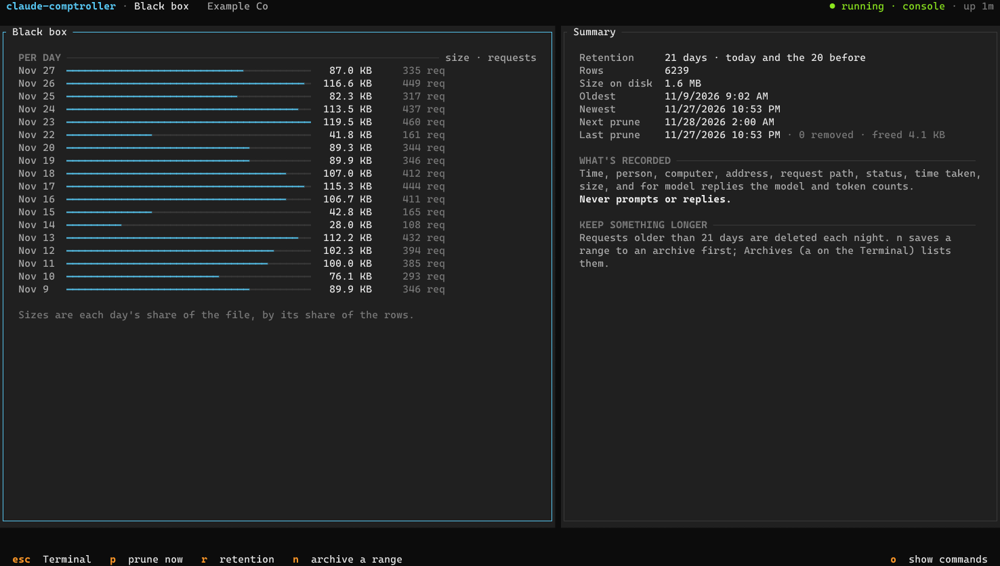<br><b>Black box</b> · requests and size per day, and the nightly prune</td></tr>
</table>

<table>
<tr>
<td width="50%" valign="top">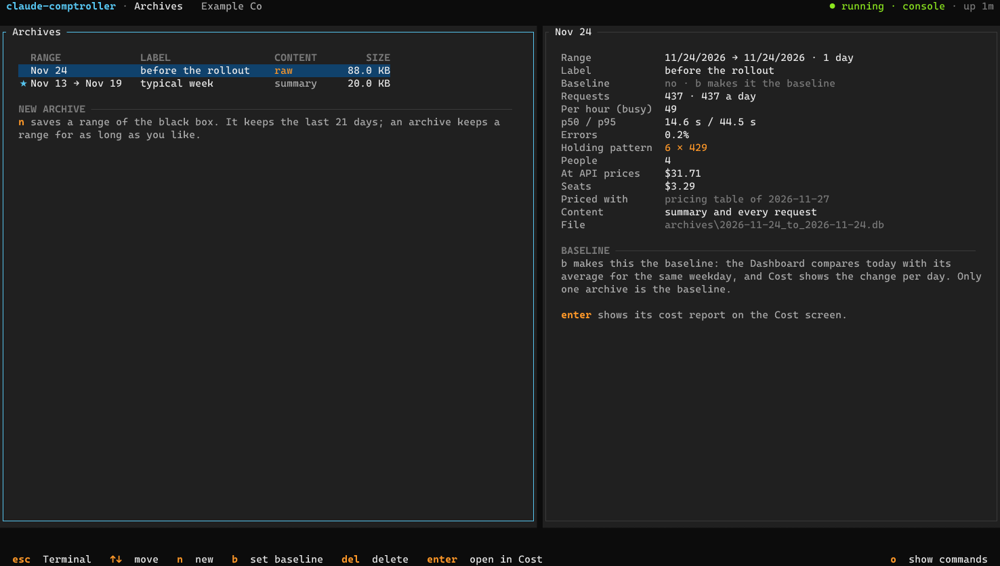<br><b>Archives</b> · saved ranges; the ★ one is the baseline</td>
<td width="50%" valign="top">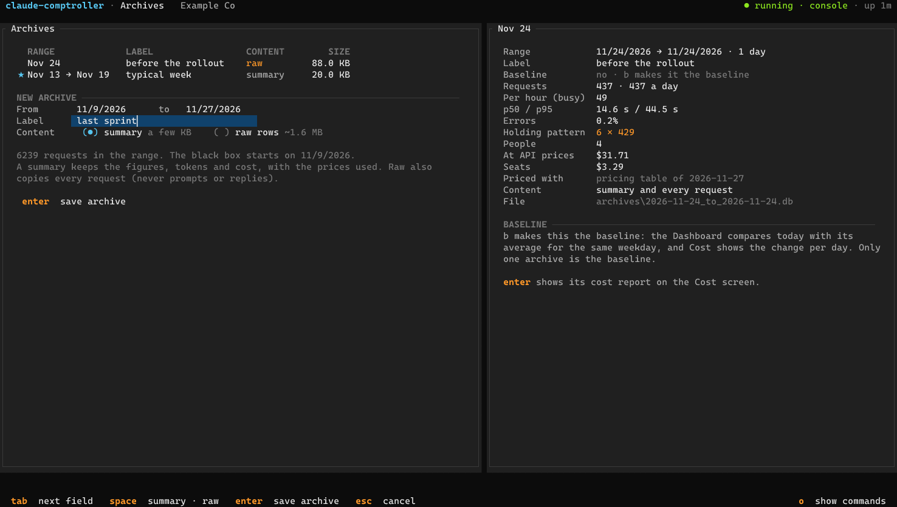<br><b>New archive</b> · <code>n</code> on Archives or the Black box</td>
</tr>
</table>

## Configuration

One file, `comptroller.json`, beside the service. The admin terminal's Settings screen edits it; by hand, start from [contracts/comptroller.sample.json](contracts/comptroller.sample.json). Changes apply while running, except the listen URL, admin port, shutdown timeout, data folder and logging. An invalid file is ignored and the last good one stays in use.

| Setting | Default | Meaning |
| - | - | - |
| `General.OrganizationName` | empty | Shown in the tray app and on the setup page |
| `Proxy.ListenUrl` | `http://localhost:8080` | Where the service listens. `https://…` needs a certificate (below); `+` as the host listens on every address |
| `Proxy.AdminPort` | 8081 | Port for `/health`, on `127.0.0.1` only |
| `Proxy.ShutdownTimeoutSeconds` | 60 | How long a stop waits for replies in flight (5–600) |
| `Proxy.UpstreamUrl` | `https://api.anthropic.com` | Where requests go |
| `Proxy.ActivityTimeoutMinutes` | 10 | How long a silent request may last (1–60) |
| `Proxy.StripForwardedHeaders` | true | Don't add `X-Forwarded-*` |
| `Access.AllowedCidrs` | this computer only | Networks that may connect. Empty allows any |
| `Identity.Mode` | `windows` | `windows`, or `manual` for one-time codes |
| `Identity.AllowedGroup` | `Claude Code Users` | Windows group name or SID that may connect |
| `Identity.TokenLifetimeDays` | 7 | 1–90. The tray app refreshes the token before then |
| `Identity.CodeLifetimeHours` | 24 | How long a one-time code works (1–168) |
| `Identity.TokenHeaderName` | `X-Comptroller-Token` | |
| `TLS.CertificateThumbprint` | empty | The certificate for an `https://` listen URL, by thumbprint (spaces are ignored). The admin terminal lists and picks them |
| `TLS.CertificateStore` | `LocalMachine` | Where to find it. `CurrentUser` only for a console run, such as testing on a laptop |
| `Data.Folder` | `data` | Database folder, relative to the config file |
| `Data.RetentionDays` | 14 | Days of requests kept: today and the days before it (1–365) |
| `Data.PruneTime` | `02:00` | When the nightly prune runs, on the server's clock (24-hour in the file; the admin terminal shows and takes your local format) |
| `Logging.Folder` · `Level` · `RetainedFiles` · `FileSizeLimitMb` | `logs` · `Information` · 14 · 20 | Level: `Verbose` to `Fatal`. Files kept 1–365, size 1–1024 MB |
| `Cost.Currency` · `MonthStartDay` · `PricingFile` · `SeatPlans` | `$` · 1 · `pricing.json` · Team standard, annual | Admin terminal only. Seat plans have a billing period (`annual` or `monthly`), a price and, for annual plans, a renewal date |
| `Dashboard.RefreshSeconds` · `P95WarningSeconds` · `ErrorRateWarningPercent` | 2 · 10 · 5 | Admin terminal only |
| `Archives.Folder` · `DefaultContent` · `Baseline` | `data\archives` · `summary` · none | Admin terminal only. The baseline is an archive's file name |

**API prices** come from [contracts/pricing.json](contracts/pricing.json), copied from [Anthropic's pricing page](https://platform.claude.com/docs/en/about-claude/pricing) on the date it gives, and built into the admin terminal. The Cost screen warns when it's over 90 days old. To change prices, save a copy as `pricing.json` beside `comptroller.json`. Models are matched by family and version (`claude-opus-5-5-20261001` is Opus 5.5); tokens on a model that isn't in the table are listed, not priced.

Without the admin terminal, the service can print a one-time code for `manual` mode:

```powershell
claude-comptroller-service.exe --config comptroller.json --create-code jdoe LAPTOP-1
```

## Known limits

- Only Claude Code traffic goes through the service. Claude Desktop's Chat and Cowork tabs don't.
- Remote Control is unavailable while `ANTHROPIC_BASE_URL` points anywhere but Anthropic.
- The Claude Desktop Code tab hasn't been tested.
- Claude Code sends some non-model traffic (version checks, telemetry, sign-in) directly to Anthropic.
- Optional hardening: deliver `ANTHROPIC_BASE_URL` with `allowedProviders: ["customEndpoint"]` through managed settings (Intune or Group Policy), so Claude Code refuses any other destination even if someone edits their settings. Needs Claude Code 2.1.285 or later.

## Build from source

Needs Windows, the [.NET 10 SDK](https://dotnet.microsoft.com/download/dotnet/10.0) and [Rust](https://rustup.rs) (stable, MSVC).

```powershell
.\build.ps1          # publish the service, build the tray app, build the admin terminal with both inside
.\build.ps1 -Test    # run every test suite first
```

It checks that the four version numbers agree (the service's `.csproj`, both `Cargo.toml` files and `connect/tauri.conf.json`), and writes `dist\claude-comptroller-<version>-win-x64.zip`, `dist\claude-comptroller-connect-<version>-win-x64.zip` and `dist\SHA256SUMS.txt`. Pushing a tag such as `v0.2.0` runs the same build on GitHub and publishes a release.

### Try it on one computer

```powershell
.\dev.ps1          # fake upstream: uses no seat
.\dev.ps1 -Seed    # the same, after adding three weeks of traffic from four example people
.\dev.ps1 -Real    # the real api.anthropic.com: uses your seat
.\dev.ps1 -Https   # on https://localhost:8443 with the .NET development certificate (combines with the others)
```

`-Https` uses the certificate `dotnet dev-certs https --trust` makes for `localhost`. Windows trusts it on that computer only, so Claude Code and the tray app accept it there.

Then run the lines it prints in a second terminal. They set environment variables for that terminal only, so closing it puts everything back. If you put these variables in a Claude Code or VS Code settings file instead, remove them before you stop the service: Claude Code can't work while it points at a service that isn't running.

The tray app can run without touching your real settings:

```powershell
cargo run --manifest-path connect\Cargo.toml -- --settings-root dev\sandbox --server http://localhost:8080
```

`--device-name <name>` registers the same computer as another device.

### Tests and pictures

- `dotnet test service/Comptroller.slnx`: the service, end to end against the fake upstream
- `cargo test --manifest-path connect/Cargo.toml`: the tray app (after building the service)
- `cargo test --manifest-path tui/Cargo.toml`: the admin terminal
- `.\dev\service-test.ps1` (administrator): installs a temporary Windows service, tests it and removes it
- `.\tools\screenshots.ps1`: redraws the pictures in `docs/images` from example data

## License

[MIT](LICENSE)
